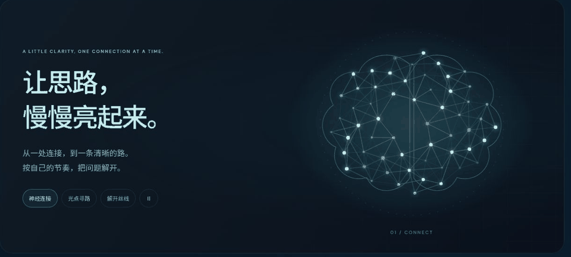
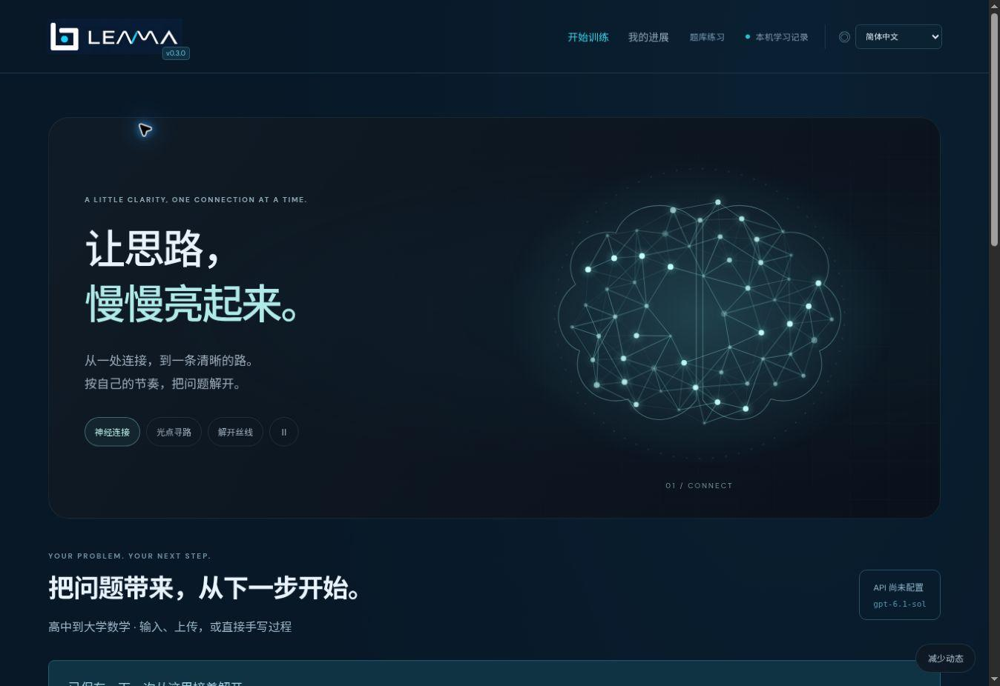
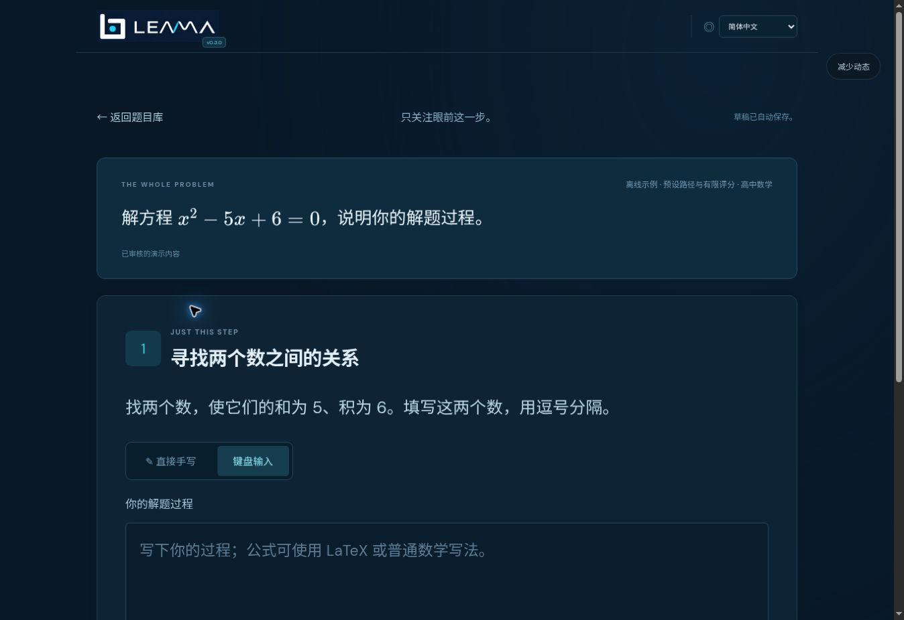

<p align="center">
  
</p>
<h1 align="center">Small steps. Real understanding.</h1>
<p align="center"><strong>一步步，解开。</strong><br/>An AI mathematics learning prototype that helps students build a way through a problem.</p>
<p align="center"><strong>v0.3.0</strong> · LLM Applications · Adaptive Tutoring · Multimodal Learning</p>
<p align="center"><a href="#the-product">Product</a> · <a href="#see-it-in-motion">Motion preview</a> · <a href="#run-locally">Run locally</a> · <a href="docs/SETUP.zh-CN.md">中文说明</a></p>

## The product

LEMMA explores a gap between getting an answer and being able to reason through a problem independently. It is designed for high school and university students who feel overwhelmed by mathematics, lose their train of thought, or struggle to turn conceptual understanding into a complete solution.

The product turns LLM capabilities into a guided learning workflow: make the next step achievable, preserve the learner's own reasoning, and gradually reduce support. This is an early product hypothesis for secondary and higher education, not a claim of validated market demand, revenue, or measured learning gains.

## See it in motion



*Captured from the running v0.3.0 product. The GIF shows excerpts of three animation modes; it is a visual preview, not an AI tutoring session.*

The arrival starts in darkness. **“一步步，解开。”** appears, neural connections gradually light up, and the interface comes into view. The opening is skippable and appears once per browsing session. Returning directly to a solving session bypasses it.

Neural connections, pathfinding light and untangling threads share a restrained navy-and-cyan visual language. Motion can be paused or reduced, and system reduced-motion preferences are respected. The solving page removes the animated showcase so the current task stays central.



## From a problem to the next step

1. **Bring a question.** Type a problem or upload text, an image or a PDF.
2. **Build an approach.** The model proposes a structured plan with private answer criteria; a second model pass reviews the plan before use.
3. **Work one step at a time.** Submit reasoning, request a smaller step or ask for a hint. An uncertain assessment remains uncertain.
4. **Take ownership.** Reduce guidance or start an independent attempt. After completing a problem, request a similar question as a separate attempt.



### Product and engineering highlights

- **Adaptive LLM workflow:** structured problem decomposition, intermediate-work evaluation, step splitting and model-generated follow-up practice.
- **Learning evidence:** original submissions and assistance history are retained; using help changes the recorded assistance status. Independent attempts hide strategy hints and private answers.
- **Integrated handwriting:** write directly in the app, save original ink locally, and edit transcription on the same page. With an API configured, transcription runs after a writing pause.
- **Comfortable solving:** a dedicated route, large prompts and feedback, generous spacing, and both handwriting and keyboard input.
- **Continuity:** local drafts, ink and uploaded originals survive ordinary navigation and refresh. Local browser storage is not cross-device synchronization.

## Run locally

**Prerequisite:** Node.js 22.12+ and npm.

```sh
git clone https://github.com/Fjj040806/LEMMA-.git
cd LEMMA-
npm ci
npm run dev
```

Open the URL printed in the terminal (normally `http://localhost:3000`). Keep the terminal running. The header should show **v0.3.0**.

**Windows shortcut:** double-click `START_WINDOWS.cmd`. It builds the current folder, finds an available port starting at 3107, verifies the release and opens the application. Use that newly opened URL if an older localhost tab is still running.

### Enable model-backed features

Copy `.env.example` to `.env`, add your server-side key, then restart:

```dotenv
OPENAI_API_KEY=your_api_key_here
OPENAI_MODEL=gpt-6.1-sol
OPENAI_REASONING_EFFORT=medium
```

The backend uses the Responses API. The model is configurable and requires access under your API account. Keep credentials on the server; never use a `VITE_` prefix for keys or commit `.env`.

| Works without an API key | Requires a configured API key |
| --- | --- |
| Six authored cross-topic examples with finite accepted answer forms | Open-ended mathematics tutoring |
| Keyboard and handwriting canvas; local draft and ink saving | Image/PDF and handwriting transcription |
| Text import and immersive visual interface | Dynamic step splitting and similar-question generation |

Without a key, model-backed actions return an explicit unavailable state; the app does not simulate successful recognition or AI generation.

## Architecture

| Layer | Implementation |
| --- | --- |
| Interface | React, TypeScript, Vite, KaTeX; CSS/SVG motion |
| Notebook | IndexedDB for drafts, uploads and ink |
| Backend | Express; server-side Responses API calls |
| Tutoring contracts | Zod schemas, dependency checks, public/private session separation |
| Session access | Random capability tokens; server-side session storage |
| Learning workflow | Guidance state, assistance events, idempotent submission/action requests |

```text
src/components/        Brand, motion and shared interface
src/math/              General-math workspace, handwriting and notebook
src/domain/            Authored training and assessment logic
src/i18n/              Language catalog and rendering
server/model.ts        Model/API boundary
server/tutor/          Planning, assessment, sessions and authored demos
tests/                 Domain, disclosure, upload, ink and model-contract checks
docs/assets/           Product logo, screenshots and captured animation GIF
```

## Validation and current limits

```sh
npm test
npm run build
```

The current suite has **25 passing tests**. The production build passes. Browser checks cover desktop and narrow layouts, animation selection and pause, saved reduced-motion preference, and the dedicated solving flow.

This is a prototype. Live paid model calls and actual iPad/Apple Pencil behavior have not been validated in this development environment. API tests use mocks. Model review is not a mathematical proof; broad topic input is not a guarantee that every problem can be solved correctly. Learning outcomes, retention and commercial demand still require user studies.

Before a public multi-user deployment, the prototype also needs production hosting, durable multi-user storage, account/access design and operational cost controls. This repository publication does not deploy a live tutoring service.

## Product direction

The next validation priorities are whether learners can complete the next step with less friction, return to practice, and solve an unseen related problem with less support. The aim is to make complex reasoning approachable while preserving the student's own work.

## License

See [LICENSE](LICENSE) for the repository's existing license.
